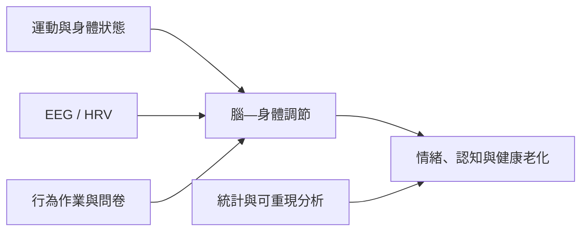

# Ting-Ting Wu 吳亭葶｜個人學術網站

這是一個以「運動、情緒與認知」為主軸的雙語學術入口。網站整合個人研究介紹、學術發表、科普與方法文章、專業學習地圖、互動認知作業，以及可重現研究工作流。

網站：<https://wttntpc.github.io/tingwu.github.io/>

## 研究架構



核心問題不是只問運動「有沒有效」，而是進一步理解：

- 運動如何影響情緒處理、執行功能與心理健康？
- EEG、HRV、行為與自陳各自提供哪一層證據？
- 不同個體在運動反應上為何不同？
- 如何把研究結果轉化為更精確的運動處方與健康老化建議？

## 網站入口

- `#/research`：研究主軸、研究框架與互動示範
- `#/publications`：期刊論文、研討會發表與獲獎紀錄
- `#/blog`：科普、研究方法、數據分析與 AI 工作流文章
- `#/learning`：認知神經科學、EEG、HRV、運動生理與統計學習路徑
- `#/lab`：Posner、Go/No-Go、停止訊號、情緒側翼等互動作業

## 技術與內容架構

本站使用原生 HTML、CSS 與 JavaScript，無需框架即可在 GitHub Pages 執行。文章來源位於 `posts/`，索引資料位於 `posts.json`；`tools/build-static.js` 會產生可被搜尋引擎與社群預覽讀取的靜態文章頁、RSS 與 sitemap。

本機檢查：

```powershell
node --test tests/*.test.js
node tools/build-static.js
```

## 引用

若研究、教學或技術文章引用此網站的研究框架或互動資源，請參考 [`CITATION.cff`](CITATION.cff)。個別文章若列有原始文獻，仍應優先引用該原始研究。

## 使用說明

本站是個人學術與知識分享網站，不構成醫療或其他專業建議。部分內容由 AI 協作整理，但由網站作者負責選題、查核與公開呈現。重要決策請回到原始研究、官方規範與專業人員。

除個別檔案另有標示外，網站文字、圖片與程式的權利仍歸各自權利人所有；請勿因原始碼公開而推定所有內容均採開放授權。
